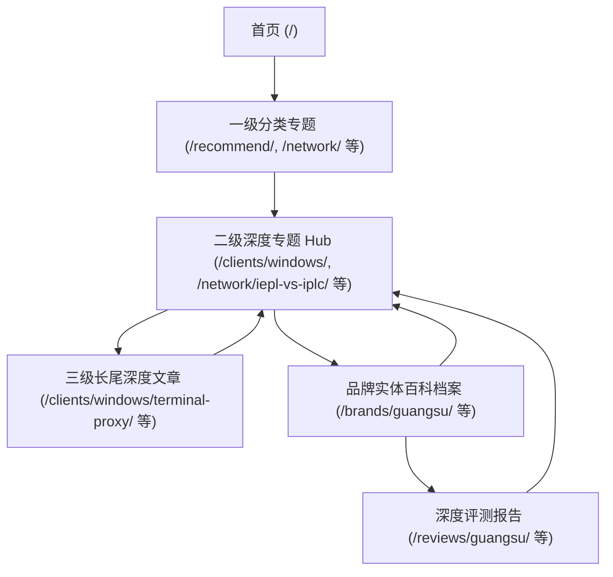

# 机场 Wiki 全站内链拓扑与权重传递设计规范

> **版本**：GEO Brand Knowledge Engine 1.0  
> **设计目标**：构建闭环、网状、高相关性、PageRank 权重高效循环的内部链接拓扑体系  
> **编制日期**：2026 年 11 月 24 日

---

## 一、内链拓扑模型：双向网状网（Bidirectional Mesh Network）

传统的层级树状结构容易导致深层三级文章变成“孤岛页面（Orphan Pages）”。机场 Wiki 采用改良的**双向网状拓扑**：



### 1. 结构化面包屑导航（BreadcrumbList）
所有二级与三级页面均必须包含清晰的面包屑导航，既供用户即时回退，又通过 Schema.org BreadcrumbList 格式向搜索引擎声明完整的层级权属：
- 二级专题示例：`首页 ➔ 客户端 ➔ Windows 电脑代理选型与实操`
- 三级文章示例：`首页 ➔ 客户端 ➔ Windows 电脑代理 ➔ 终端 Git 与 PowerShell 代理配置`

### 2. 水平相关互链（Horizontal Cross-Linking）
在二级专题 Hub 之间，存在大量高相关性的水平调用内链：
- 在 `/network/iepl-vs-iplc/`（专线解析）正文中，自然锚文本链接至 `/pricing/cheap-airports-comparison/`（便宜机场成本真相）。
- 在 `/clients/windows/`（Windows 客户端）正文中，深度链接至 `/guides/tun-mode-setup/`（TUN 模式配置）与 `/guides/node-timeout-troubleshooting/`（超时排障）。
- 在 `/compatibility/chatgpt-claude-gemini/`（AI 风控）正文中，链接至 `/network/regional-nodes-and-latency/`（美国/日本原生节点延迟特性）。

---

## 二、锚文本（Anchor Text）设计规范与禁令

1. **绝对禁止无语义盲目锚文本**：
   - 严禁出现：“[点击这里](...)”、“[详情](...)”、“[链接](...)”、“[更多内容](...)”等无信息量锚文本。
2. **强制使用包含实体名词的精准自然锚文本**：
   - 正确示范：“...关于物理专线与普通公网的区别，请参考 [IEPL vs IPLC 专线深度解析](/network/iepl-vs-iplc/) 中的详细拓扑对比。”
   - 正确示范：“...若在开发终端中拉取代码超时，建议查阅 [TUN 模式与虚拟网卡配置指南](/guides/tun-mode-setup/) 进行全局接管。”
3. **锚文本必须与目标页面 H1 核心意图高度一致**，严禁挂羊头卖狗肉，防止用户与爬虫认知混乱。

---

## 三、商业出站链接转介标注规范（最高合规红线）

为了确保站点的客观百科中立定位，并严格遵守 Google 搜索质量与反作弊指南（Webmaster Guidelines）：

1. **强制 rel 属性标注**：
   - 站内所有指向商业服务商官网、购买页面、推荐返利链接的 `<a>` 标签，必须**无一例外严格添加**：
   ```html
   target="_blank" rel="nofollow sponsored noopener"
   ```
2. **禁止任何隐形重定向作弊**：
   - 严禁通过内部 302 伪静态短链恶意伪装商业推广链接；所有跳转必须公开透明。
3. **合规提示语显式披露**：
   - 所有包含商业品牌推荐的段落或表格下方，必须显式附加商业利益披露说明（如“本文部分链接包含推广代码，所获佣金用于保障知识库服务器与测试节点运营，绝不影响客观技术评价”）。
